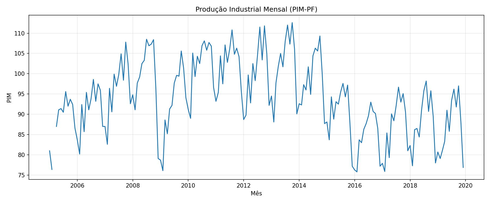
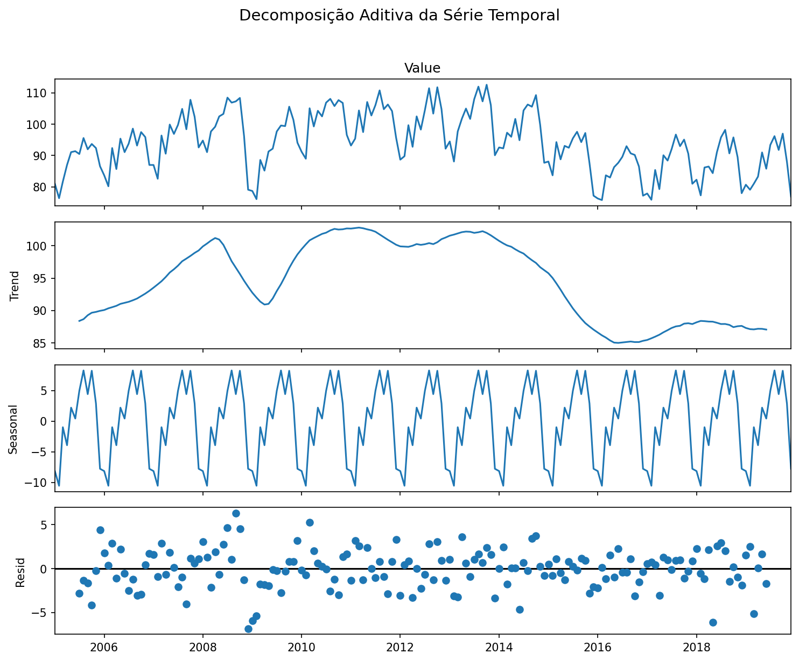
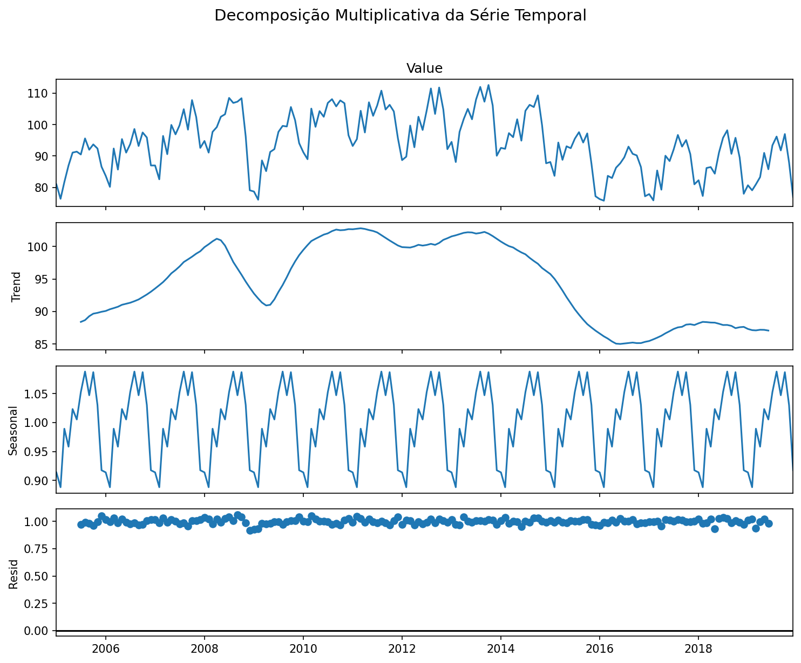

# 📈 Análise de Séries Temporais — Produção Industrial Mensal (PIM-PF)

Projeto acadêmico desenvolvido em **Python** para praticar conceitos introdutórios de **Análise de Séries Temporais** a partir de dados mensais da Produção Industrial (PIM-PF).

O projeto parte de uma atividade realizada no Google Colab e organiza o processo de importação, preparação, visualização e decomposição da série temporal.

## 🎯 Objetivo

O objetivo é observar o comportamento da série ao longo do tempo e separar seus principais componentes — **tendência, sazonalidade e resíduo** — utilizando decomposição aditiva e multiplicativa.

## 🧰 Tecnologias

- Python
- Pandas
- Matplotlib
- Statsmodels
- OpenPyXL
- Google Colab / Jupyter Notebook

## 📁 Estrutura do projeto

```text
analise-series-temporais-pim/
├── README.md
├── analise_series_temporais.py
├── codigo_original.py
├── requirements.txt
├── .gitignore
├── dados/
│   ├── README.md
│   └── pim.xlsx                 # adicionar a planilha aqui
└── graficos/
    ├── README.md
    ├── 01_serie_temporal.png
    ├── 02_decomposicao_aditiva.png
    └── 03_decomposicao_multiplicativa.png
```

## 🔎 Etapas da análise

### 1. Importação e inspeção

Os dados são carregados com `pandas.read_excel()`. Em seguida, `head()` e `info()` permitem observar as primeiras linhas, os nomes das colunas e seus tipos.

### 2. Preparação dos dados

A coluna `Value` é convertida para formato numérico. Valores que não puderem ser convertidos são transformados em `NaN`. A coluna `Month` é convertida para data e as observações são ordenadas cronologicamente.

### 3. Visualização da série

O primeiro gráfico mostra a evolução da Produção Industrial ao longo do período analisado.



> O arquivo acima é criado automaticamente após executar o projeto com `pim.xlsx`.

### 4. Tratamento de valores ausentes

Valores ausentes são tratados por **interpolação linear**, que estima um ponto ausente com base na sequência de valores próximos.

### 5. Decomposição aditiva

A decomposição aditiva considera, de maneira simplificada:

**Série = Tendência + Sazonalidade + Resíduo**

Como os dados são mensais, foi utilizado `period=12`, representando um ciclo anual.



### 6. Decomposição multiplicativa

Também é testada a decomposição multiplicativa:

**Série = Tendência × Sazonalidade × Resíduo**

Esse modelo é executado quando os valores da série são positivos.



## 📚 Conceitos principais

**Tendência** representa movimentos de crescimento ou redução observados ao longo do tempo.

**Sazonalidade** representa comportamentos que se repetem em intervalos regulares. Para dados mensais, um padrão anual corresponde a 12 observações.

**Resíduo** representa a parcela que permanece depois de considerados os componentes de tendência e sazonalidade.

## ▶️ Como executar

1. Baixe ou clone este repositório.
2. Coloque a planilha `pim.xlsx` dentro da pasta `dados/`.
3. Instale as dependências:

```bash
pip install -r requirements.txt
```

4. Execute:

```bash
python analise_series_temporais.py
```

Os gráficos serão salvos automaticamente na pasta `graficos/`.

## 💡 Aprendizados

A atividade permitiu praticar importação e preparação de dados, conversão de tipos, tratamento de valores ausentes, visualização de séries temporais, manipulação de datas e decomposição sazonal com modelos aditivo e multiplicativo.

Um ponto importante do exercício foi perceber que a preparação dos dados faz parte da análise: antes da decomposição, foi necessário garantir que os valores fossem numéricos, as datas estivessem corretamente interpretadas e os dados ausentes fossem tratados.

## 🚀 Próximos passos

Como evolução do projeto, podem ser estudados testes de estacionariedade, análise dos resíduos e modelos de previsão de séries temporais.

## 👩‍💻 Autora

Projeto desenvolvido para fins acadêmicos durante os estudos em **Ciência de Dados**.
